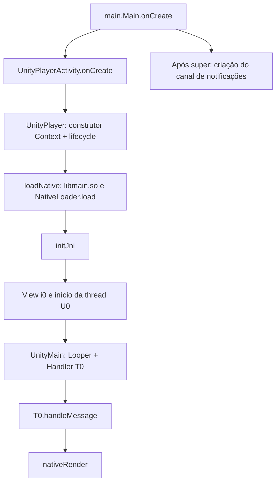

# Inicialização Android e fronteira nativa

Data: 2026-10-25. APK SHA-256 `d58943e6ed4137975a554f1e210853f4a7b41573a38dbb462f4f5e159bf6eead`. Análise estática com REA 6.5.0 e JADX headless MCP 0.7.1. Não houve execução do jogo.

Atualização: [conferência em smali](08-smali-validation.md) resolveu a estrutura do fallback de carregamento, os blocos compartilhados de foco e as condições de reagendamento. As ressalvas originais abaixo registram o estado inicial da decompilação; timing e comportamento em execução continuam desconhecidos.

## Fluxo observado



As arestas representam chamadas e inicialização recuperadas, não uma captura temporal do runtime. O fluxo interno de `NativeLoader.load`, a resolução JNI e a primeira cena ainda não estão mapeados.

1. `main.Main.onCreate(Bundle)` chama a implementação superior e depois `plugin.Utility.CreateNotificationChannelIfNeeded()`.
2. `UnityPlayerActivity.onCreate(Bundle)` solicita o recurso de janela 1, chama `Activity.onCreate`, atualiza argumentos do Intent, instancia `UnityPlayer(this, this)`, instala a view com `setContentView` e solicita foco. A referência de exibição `TapjoyConstants.TJC_PLUGIN_UNITY` usada pelo JADX não prova uma chamada Tapjoy nesse caminho.
3. O construtor de `UnityPlayer` com `(Context, IUnityPlayerLifecycleEvents)` cria estado, fila de eventos e thread `U0`; captura activity, orientação e URI; prepara splash e plugins Java; chama `loadNative`; verifica `W0.d()` e, no caminho aceito, chama `initJni(context)`, cria `i0`, configura serviços Android e inicia a thread.
4. `loadNative(String)` tenta carregar `<diretório>/libmain.so` via `System.load`, contém um caminho com `System.loadLibrary("main")` e chama `NativeLoader.load`. Se esse último retorna verdadeiro, chama `W0.e()`. A estrutura de exceções decompilada deve ser conferida em smali antes de reconstruir o fallback.
5. `U0.run()` dá à thread o nome `UnityMain`, prepara um `Looper`, registra `T0` como callback de um `Handler` e entra em `Looper.loop()`.
6. `T0.handleMessage(Message)` filtra `what == 2269`. O ramo `S0.h` executa jobs GL e, sob condições de estado/janela, chama `nativeRender()`. Se o retorno é falso e a activity não estava finalizando, chama `finish()`. Outros ramos alteram flags, foco, orientação e URI. Ao final há reagendamento de `S0.h` quando `b` está ativo e `e <= 0`.

**Limite importante:** o JADX marcou código duplicado/PHI no handler. Os ramos recuperados são evidência estática parcial para inferir a organização do loop, não base suficiente para reproduzir fielmente timing, pausas ou foco. Não foi determinado FPS, timestep, sincronização com display ou ritmo da simulação nativa.

## Input e fronteiras

`UnityPlayerActivity.onTouchEvent(MotionEvent)` delega a `mUnityPlayer.onTouchEvent`. Este retorna falso se `mGlView.c()` for verdadeiro; caso contrário chama `injectEvent(event)`. Esse overload encaminha para `injectEvent(event, 0)`. O overload com inteiro chama `nativeInjectEvent` quando `W0.d()` é verdadeiro e retorna falso no outro caso. A semântica de `mGlView.c()` ainda não foi investigada; não inferir escalas, coordenadas ou gestos a partir desses wrappers.

`initJni(Context)` e `NativeLoader.load(String)` existem, mas a inspeção retorna `body_status=not_available` e indica método native/abstract. Este resultado, sozinho, não distingue os dois modificadores. Os nomes e o contexto sugerem a fronteira JNI; a implementação e o registro de funções exigem inspeção nativa.

## Índice de evidências

JSONs completos em `research/local/`, excluídos do Git; incluem APK/JAR hashes, protótipos DEX, engine, código decompilado e limitações. Não distribuir código decompilado.

| Arquivo local | Símbolo / resultado | Evidence ID |
|---|---|---|
| `main-oncreate.json` | `main.Main.onCreate(Bundle)` | `ev_58d6ca4d7212dc3172239c3b19e129b199d80c0e0247e8b53a5d468abd132996` |
| `unity-activity-oncreate.json` | `UnityPlayerActivity.onCreate(Bundle)` | `ev_7c597637d5d8f36166b2a999a1ef3eee08f6ffaed3bd42d346a450f0b20c0626` |
| `unity-constructor.json` | `UnityPlayer.<init>` overload 1 | `ev_7adef87b610df7aa569e1f721a29d20dbd1aef7e3ab1246f40a16ad2a26eba9f` |
| `unity-loadnative.json` | `UnityPlayer.loadNative(String)` | `ev_fb1b7be3b0062188f98922b4dc7c8a599969aada8eb9759a2745ac66eca45c1b` |
| `unity-thread-run.json` | `U0.run()` | `ev_a06f45bd43fa57d8d5ee94d6216846343d33375b12d9e7ed310c425d1fb2a044` |
| `unity-handle-message.json` | `T0.handleMessage(Message)`, com warning | `ev_dcdcfcc05b5a0896e678e4afa5b6fc19527c110725f0040faccdfddd022213c2` |
| `unity-injectevent.json` | `UnityPlayer.injectEvent`, overload 1 | `ev_bd9182eeac4fb6c330a023a2185aaaebf7e2c2366493c770e82d0f2534d8401f` |
| `unity-touch-retry.json` | `UnityPlayerActivity.onTouchEvent` | `ev_7facf0f10e1e46c1d0f604f8ba5cdd2adaeaa31c15efa362d8e69e20ba50c5ea` |
| `unity-player-touch.json` | `UnityPlayer.onTouchEvent` | `ev_3b47e5067c1d6b6418a07c35f4b329f5e3c9b83ae4aaf438835222dbd45c91fb` |
| `unity-injectevent-default.json` | `UnityPlayer.injectEvent`, overload 0 | `ev_c917a97d96ad62aed54ec53c4993c71ade1b3205925f20319eb340e335e3f5ff` |
| `unity-initjni.json` | `UnityPlayer.initJni`, corpo indisponível | `ev_cb89de44bbf3d29d4e9608f1475f4df01173ab4949ef56ad72b9ba37d38468fe` |
| `unity-native-loader-load-retry.json` | `NativeLoader.load`, corpo indisponível | `ev_e6f1d541c4c323c443d89b445c00a2bede2fa81c852f78ea24858eb20490997b` |

## Reprodução e verificação

Executar na raiz, uma consulta por vez:

```powershell
tools\rea-local.cmd inspect-android-class "Magician's+Saga_1.4.0_APKPure.apk" com.unity3d.player.UnityPlayerActivity --format json
tools\rea-local.cmd inspect-android-method "Magician's+Saga_1.4.0_APKPure.apk" com.unity3d.player.UnityPlayerActivity onCreate --overload-index 0 --format json
tools\rea-local.cmd inspect-android-method "Magician's+Saga_1.4.0_APKPure.apk" com.unity3d.player.T0 handleMessage --overload-index 0 --format json
```

Para passar `<init>` pelo wrapper CMD no PowerShell, usar stop-parsing:

```powershell
tools\rea-local.cmd --% inspect-android-method "Magician's+Saga_1.4.0_APKPure.apk" com.unity3d.player.UnityPlayer "<init>" --overload-index 1 --format json
```

O wrapper usa heap padrão de 768 MiB (sobrescrevível por `REA_JADX_HEAP_MIB`). Consultas paralelas com heap de cerca de 1.980 MiB por JVM causaram falha de commit de memória Windows 1455, saída ilegível e `cleanup_incomplete`; erros preservados em `unity-touch.json` e `unity-native-loader-load.json`. Verificação posterior não encontrou processos `java.exe`; os dois processos CLI pendentes foram interrompidos. Reexecuções sequenciais com heap reduzido terminaram com código 0.

Verificação final: 11 envelopes de métodos conferidos (operação, hash do APK e status completo da representação retornada); dois explicitamente sem corpo disponível. SHA-256 do APK inalterado. O warning no handler aparece no texto Java apesar de `markers=[]`; esse campo vazio não garante ausência de avisos.

## Próxima investigação

Conferir os ramos ambíguos do handler/fallback contra smali; mapear o registro JNI e a passagem para `libunity.so`/IL2CPP. Em paralelo conceitual, inventariar tipos/assemblies dos metadados IL2CPP para localizar `KairoLibrary` e classes de gameplay. Ainda faltam áudio, saves, RNG, progressão, carregamento completo de assets e dependências de serviços. M0 continua parcial.
